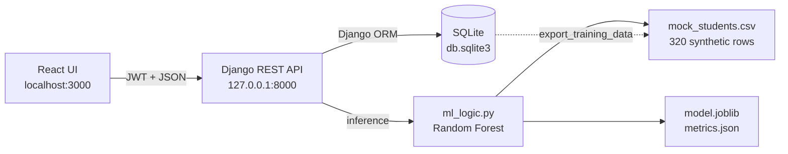

# EduPredict — Student Performance Predictor

A **local-only** MVP web application that predicts whether a student is likely to pass
or fail a course, so that lecturers and personal tutors can prioritise support.

This repository is the portfolio submission for **Assessment Brief 2** (LO3, LO4).
It runs entirely on one computer — **no Docker, no MySQL server, no cloud services and
no public hosting are required**.

| | |
|---|---|
| **Frontend** | React 19 (Create React App), runs on `http://localhost:3000` |
| **Backend** | Django 6 + Django REST Framework, runs on `http://127.0.0.1:8000` |
| **Database** | SQLite 3 — a single local file (`db.sqlite3`) |
| **AI** | scikit-learn Random Forest binary classifier |
| **Auth** | JWT (SimpleJWT), local demo account |
| **Report** | [docs/ASSESSMENT_REPORT.md](docs/ASSESSMENT_REPORT.md) |
| **Screenshots** | [docs/screenshots](docs/screenshots) |

---

## 1. Quick Start Guide

### Prerequisites

- Python 3.12 or newer
- Node.js 18 or newer
- PowerShell on Windows

### 1. Set up the project

Open PowerShell in the project root and run:

```powershell
.\setup_local.ps1
```

This creates the virtual environment, installs the backend and frontend dependencies,
applies the SQLite migrations, trains the AI model and loads the mock data plus the demo
account.

If PowerShell blocks the script, run:

```powershell
powershell -NoProfile -ExecutionPolicy Bypass -File .\setup_local.ps1
```

### 2. Start the app

```powershell
.\run_local.ps1
```

This opens the Django API and React app in two PowerShell windows. You can also
double-click `run_local.bat`.

### 3. Open the app

| Service | URL |
|---|---|
| Web app | http://localhost:3000 |
| REST API | http://127.0.0.1:8000/api/ |
| Django admin | http://127.0.0.1:8000/admin/ |

**Demo login:** `demo` / `demo12345`

The demo account is a local superuser, so the same credentials open both the web app and
the Django admin.

### Manual setup

If you prefer to run each step yourself:

```powershell
python -m venv venv
.\venv\Scripts\python.exe -m pip install -r requirements.txt

.\venv\Scripts\python.exe manage.py migrate
.\venv\Scripts\python.exe manage.py generate_mock_data
.\venv\Scripts\python.exe manage.py train_model
.\venv\Scripts\python.exe manage.py seed_data

.\venv\Scripts\python.exe manage.py runserver 127.0.0.1:8000
```

In a second terminal:

```powershell
cd frontend
npm install
npm start
```

---

## 2. What changed to make it local-only

The original version used Docker Compose, a MySQL container and a cloud-style
deployment. Those moving parts have been removed and replaced with a simpler local
stack that still satisfies every assessment requirement:

| Original (cloud/container) | Local replacement |
|---|---|
| MySQL 8 container | SQLite file at `db.sqlite3` |
| `docker-compose up` | `setup_local.ps1` + `run_local.ps1` |
| `mysqlclient` Python package | bundled `sqlite3` (nothing to install) |
| `ALLOWED_HOSTS = ['*']`, CORS open to all | `127.0.0.1` / `localhost` only |
| Manual `entrypoint.sh` database wait | Django migrations run locally |
| MySQL credentials in settings | no database server credentials at all |

The app is deliberately **not deployed publicly**. Only the local React development
server is allowed to call the API.

---

## 3. What the app does

1. A tutor logs in with a username and password.
2. They add a student record with three AI input features:
   **weekly study hours**, **attendance %** and **previous assessment score %**.
3. The model immediately returns:
   - **Pass / Fail** prediction,
   - **pass probability** (0–1),
   - **confidence** (%), and
   - **risk level** (Low / Medium / High).
4. The prediction is saved with the student and an audit entry is written to
   `PredictionRecord`.
5. The dashboard shows pass/fail counts, high-risk students and live model metrics
   (accuracy, precision, recall, feature importance).
6. An **Instant AI check** panel runs a prediction without saving a student record.
7. Records can be edited (the model re-runs) or deleted.
8. Where the real outcome is known, the table highlights prediction mismatches so the
   model's errors are visible.
9. The Django admin provides a second view of the database tables for evidence.

Screenshots: [login](docs/screenshots/01-login.png),
[dashboard](docs/screenshots/02-dashboard.png),
[instant prediction](docs/screenshots/03-instant-prediction.png),
[admin student table](docs/screenshots/04-admin-students.png),
[admin prediction history](docs/screenshots/05-admin-predictions.png).

---

## 4. Architecture



There are no external network calls. The browser only talks to the local Django API,
and Django only reads the local SQLite database and local model files.

---

## 5. Project layout

```
studentpredictor/
├── api/
│   ├── data/
│   │   └── mock_students.csv        # 320-row synthetic dataset
│   ├── management/commands/
│   │   ├── generate_mock_data.py    # deterministic dataset generator
│   │   ├── seed_data.py             # courses, students, demo user, predictions
│   │   ├── train_model.py           # train + evaluate (+ --from-db)
│   │   └── export_training_data.py  # database -> CSV feedback loop
│   ├── migrations/
│   ├── admin.py
│   ├── ml_logic.py                  # preprocessing, training, evaluation, inference
│   ├── mock_data.py                 # mock data assumptions
│   ├── models.py                    # Course, Student, PredictionRecord
│   ├── serializers.py
│   ├── tests.py                     # 11 automated tests
│   └── views.py
├── backend/
│   ├── settings.py                  # local SQLite + JWT + local CORS
│   └── urls.py
├── docs/
│   ├── ASSESSMENT_REPORT.md         # Tasks 1–6 in detail
│   └── screenshots/
├── frontend/
│   └── src/                         # Login, Dashboard, API client
├── db.sqlite3                       # local database (created by setup)
├── manage.py
├── requirements.txt
├── setup_local.ps1
└── run_local.ps1
```

---

## 6. API endpoints

All endpoints except register, login and health require a JWT
(`Authorization: Bearer <access>`).

| Method | Endpoint | Purpose |
|---|---|---|
| `POST` | `/api/auth/register/` | Create an account |
| `POST` | `/api/auth/login/` | Obtain access + refresh tokens |
| `POST` | `/api/auth/refresh/` | Refresh an access token |
| `GET` | `/api/students/` | List the logged-in user's students |
| `POST` | `/api/students/` | Create a student and run the model |
| `PUT/PATCH` | `/api/students/{id}/` | Update a student and re-run the model |
| `DELETE` | `/api/students/{id}/` | Delete a student + prediction history |
| `GET` | `/api/courses/` | List courses |
| `GET` | `/api/predictions/` | Prediction audit history |
| `POST` | `/api/predict/` | Ad-hoc prediction (not saved as a student) |
| `GET` | `/api/stats/` | Dashboard counts + model evaluation metrics |
| `GET` | `/api/health/` | Local health check |

Example ad-hoc prediction:

```bash
curl -X POST http://127.0.0.1:8000/api/predict/ \
  -H "Content-Type: application/json" \
  -H "Authorization: Bearer <token>" \
  -d "{\"study_hours\": 14, \"attendance\": 91, \"previous_score\": 78}"
```

Response:

```json
{
  "study_hours": 14.0,
  "attendance": 91.0,
  "previous_score": 78.0,
  "prediction": "Pass",
  "probability": 0.9152,
  "confidence": 91.5,
  "risk_level": "Low",
  "model_version": "rf-v20261109202147",
  "model_accuracy": 79.7
}
```

---

## 7. AI model at a glance

| Item | Value |
|---|---|
| Technique | Classification (binary) |
| Algorithm | `RandomForestClassifier` |
| Features | `study_hours`, `attendance`, `previous_score` |
| Target | `actual_result` → Pass / Fail |
| Dataset | 320 synthetic students (60% pass / 40% fail) |
| Split | 80% train (256) / 20% test (64), stratified |
| Preprocessing | median imputation + standard scaling in a `Pipeline` |
| Test accuracy | **79.7%** |
| Precision / recall | **77.8% / 92.1%** |
| Inference latency | ~61 ms mean per single prediction (local CPU) |

Full metrics, confusion matrix, code snippets and interpretation are in
[docs/ASSESSMENT_REPORT.md § Task 3](docs/ASSESSMENT_REPORT.md#task-3--implement-the-ai-technique).

Retrain at any time:

```powershell
.\venv\Scripts\python.exe manage.py train_model
# or close the loop from the database:
.\venv\Scripts\python.exe manage.py train_model --from-db
```

`train_model --from-db` exports every labelled `Student` row to CSV and retrains on
it, demonstrating the database → model feedback loop.

---

## 8. Tests

```powershell
.\venv\Scripts\python.exe manage.py test api -v 2
```

The suite covers:

- model quality guard rails (accuracy ≥ 70%),
- prediction payload shape and valid risk levels,
- high-risk vs low-risk input behaviour,
- input validation,
- authenticated student CRUD and automatic re-prediction,
- prediction history logging,
- ad-hoc prediction endpoint,
- per-user data isolation,
- registration and JWT login,
- anonymous access rejection.

Expected result: **11 tests, OK**.

---

## 9. Assessment mapping

| Assessment task | Where it is evidenced |
|---|---|
| Task 1 — Problem definition, users, AI rationale, inputs/outputs, mock data | Report § Task 1; `api/mock_data.py`; `api/data/mock_students.csv` |
| Task 2 — ERD, tables, keys, sample data, screenshots | Report § Task 2; `api/models.py`; `docs/screenshots/` |
| Task 3 — Preprocessing, algorithm, training, results, code | Report § Task 3; `api/ml_logic.py`; `metrics.json` |
| Task 4 — How the model works, why the technique, database–AI link, examples | Report § Task 4; `api/views.py`; `api/models.py` |
| Task 5 — Accuracy, performance, limitations, improvements | Report § Task 5; dashboard metrics |
| Task 6 — Challenges, skills, future improvements | Report § Task 6 |

---

## 10. Troubleshooting

| Problem | Fix |
|---|---|
| `Could not load data. Is the Django server running on port 8000?` | Start the backend with `.\run_local.ps1` or `python manage.py runserver 127.0.0.1:8000`. |
| Login fails | Run `python manage.py seed_data` to recreate the demo account. |
| `ModuleNotFoundError` | Activate the virtual environment or run `.\setup_local.ps1`. |
| PowerShell refuses to run scripts | Use `powershell -ExecutionPolicy Bypass -File .\setup_local.ps1`. |
| Model artifact missing | It is recreated automatically on the first prediction, or run `python manage.py train_model`. |
| Port 3000/8000 already in use | Stop the other process or run `python manage.py runserver 127.0.0.1:8001` and update `frontend/src/api.js`. |
| Empty student table | Run `python manage.py seed_data`. |

---

## 11. Local-only security note

This is a coursework MVP, not a production system:

- `DEBUG=True` by default and a development `SECRET_KEY` fallback are used.
- The demo password is intentionally public for marking.
- SQLite and the Django development server are not hardened for public traffic.
- The app binds to `127.0.0.1` and CORS only allows `localhost:3000`.

For a real deployment, set `DJANGO_SECRET_KEY`, `DJANGO_DEBUG=False`, use a production
database and server, force HTTPS and remove the demo account.
