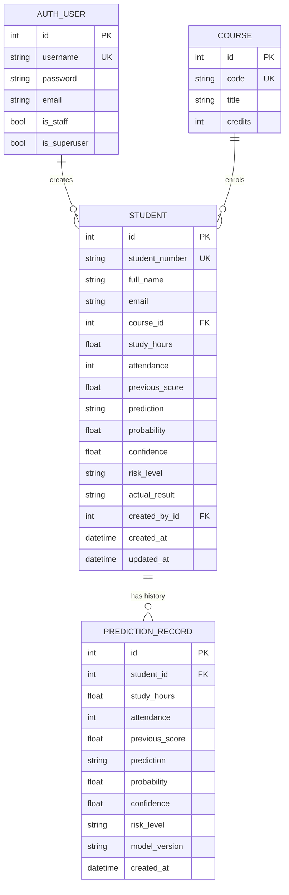
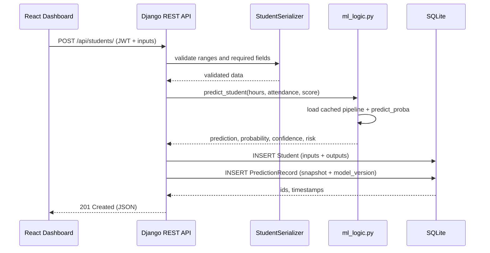

# Assessment Brief 2 — Portfolio Report

## EduPredict: A Student Performance Predictor MVP

**Learning outcomes:** LO3, LO4  
**Submission:** 08/05/26  
**Running mode:** local only (Django + SQLite + React; no cloud, Docker or MySQL)

This report maps directly to Tasks 1–6 of the assessment brief. The working
application, dataset, trained model, tests and screenshots are all included in the
repository. The README explains how to start the app locally.

---

# Task 1 — Problem Definition (MVP Web App Focus)

## 1.1 The web app idea

**EduPredict** is a small web application that predicts whether a student is likely
to **pass or fail** a course, based on a small number of behavioural and academic
indicators. It is a **binary classification** MVP.

The tutor enters:

- weekly study hours,
- attendance percentage,
- previous assessment score.

The app returns:

- a **Pass / Fail** prediction,
- the estimated **probability of passing**,
- the model's **confidence**,
- a **risk level** (Low / Medium / High).

The prediction is stored with the student, and every inference is also written to a
prediction history table. The dashboard shows the model's evaluation metrics so the
user can judge how trustworthy the prediction is.

## 1.2 Who would use it

| User | Need |
|---|---|
| **Personal tutor / lecturer** | Quickly identify which students need a check-in or additional support before the final assessment. |
| **Course leader / programme administrator** | See the number of at-risk students across a cohort and monitor attendance/study patterns. |
| **Student (future extension)** | Understand which behaviours are associated with passing and get an early warning. Students do not currently have their own login. |
| **System administrator** | Manage courses, users and the prediction audit log through Django admin. |

## 1.3 The problem it solves

Tutors often notice struggling students too late — usually after a failed exam or
assignment. Manually reviewing spreadsheets of attendance and coursework for a large
cohort is slow, inconsistent and depends on the tutor's experience. There is no easy
way to rank students by risk and decide who to contact first.

EduPredict turns three simple inputs into an immediate, probability-based risk signal.
It does not replace the tutor's judgement; it **prioritises** the tutor's limited time
by highlighting students whose combination of attendance, study time and previous
performance suggests they may fail.

## 1.4 The AI component

**What it predicts:** a binary class — `Pass` or `Fail` — plus a pass probability.

**Why AI instead of simple rules:**

A rule such as “attendance below 60% means fail” is easy to understand but has several
weaknesses:

1. **Arbitrary thresholds.** It is not obvious whether the cut-off should be 60%, 65% or 70%, and the best cut-off may differ by course.
2. **No interaction between factors.** A student with low attendance but a very high previous score may still pass; a student with good attendance but a very low previous score may fail. Rules struggle to weigh these combinations.
3. **No probability or ranking.** A rule gives a label, not a calibrated risk score, so it cannot tell a tutor who to contact *first*.
4. **No learning from outcomes.** When real pass/fail results arrive, a rule does not improve. A trained classifier can be retrained on the labelled database records.

A classifier learns the relative weights from data, outputs a probability, and can be
retrained as real outcomes become available. The app still exposes the model's test
metrics and feature importances so the prediction is not a black box.

## 1.5 Inputs and outputs

| Input | Type | Range | Source |
|---|---|---|---|
| `study_hours` | float | 0–168 per week | Tutor/student self-report |
| `attendance` | integer | 0–100% | Attendance register |
| `previous_score` | float | 0–100% | Previous assessment/coursework |

| Output | Type | Meaning |
|---|---|---|
| `prediction` | `Pass` / `Fail` | Predicted class at a 0.5 probability threshold |
| `probability` | float 0–1 | Estimated probability of passing |
| `confidence` | float 0–100% | Distance from the decision boundary (`max(p, 1-p)`) |
| `risk_level` | `Low` / `Medium` / `High` | Low if pass probability ≥ 0.75; Medium if ≥ 0.50; otherwise High |
| `model_version` | string | Identifies which trained artifact produced the result |

## 1.6 Mock data

Because the MVP has no real users, the database and training set are populated with a
**deterministic synthetic dataset** of **320 student records**.

**How it was created**

The generator in `api/mock_data.py` uses NumPy with a fixed seed (`42`). For each
synthetic student it:

1. Samples weekly study hours from a gamma distribution (clipped to 0.5–28 hours).
2. Samples attendance from a normal distribution centred on 76% (clipped to 35–100%).
3. Samples a previous score from a normal distribution centred on 62% (clipped to 25–99%).
4. Computes a weighted score:

   \[
   score = 0.45 \times \frac{previous\_score}{100}
         + 0.35 \times \frac{attendance}{100}
         + 0.20 \times \min\left(\frac{study\_hours}{20}, 1\right)
   \]

5. Labels the student `Pass` if the score is at least 0.60.
6. Randomly flips about **8% of labels** to represent unmeasured factors such as illness, motivation, assessment difficulty or personal circumstances.

The 8% label noise is deliberate. Without it the model would reach a suspiciously
perfect 100%, which would not be credible or useful for the evaluation discussion.
With it, the data is realistic, learnable but imperfect.

**Where it might come from in a real system**

- A consent-based student survey and attendance register.
- Institutional student-record systems (with ethics approval and anonymisation).
- Public education datasets, for example the UCI Student Performance dataset, used as
  a benchmark or sanity check.
- Over time, the app's own `Student.actual_result` column becomes the labelled
  training set (`manage.py export_training_data`).

No real student data is used in this submission.

**Sample rows from `api/data/mock_students.csv`**

| student_number | full_name | course_code | study_hours | attendance | previous_score | actual_result |
|---|---|---|---|---|---|---|
| STU0001 | Amelia Smith | CS101 | 9.6 | 72 | 52.0 | Fail |
| STU0002 | Noah Smith | BUS201 | 12.7 | 72 | 81.2 | Fail |
| STU0003 | Olivia Smith | NUR101 | 8.6 | 73 | 55.2 | Pass |
| STU0004 | Liam Smith | ENG102 | 7.8 | 60 | 93.4 | Pass |
| STU0005 | Isla Smith | CS101 | 13.7 | 84 | 62.0 | Pass |
| STU0006 | Ethan Smith | BUS201 | 8.2 | 83 | 67.7 | Fail |
| STU0007 | Ava Smith | NUR101 | 10.7 | 55 | 84.6 | Pass |
| STU0008 | Mason Smith | ENG102 | 10.0 | 86 | 63.8 | Pass |

STU0002 is an example of the deliberate label noise: the inputs look like a pass, but
the recorded outcome is fail. This is exactly the kind of uncertainty the evaluation
section discusses.

**Dataset summary**

| Property | Value |
|---|---|
| Rows | 320 |
| Pass / Fail | 60% / 40% |
| Mean study hours | 9.1 per week |
| Mean attendance | 75.1% |
| Mean previous score | 62.3% |
| Courses | 4 (CS101, BUS201, NUR101, ENG102) |
| Seed | 42 (reproducible) |

---

# Task 2 — Database Design

## 2.1 Entity Relationship Diagram (ERD)



The diagram is written with Mermaid and renders on GitHub. The `AUTH_USER` table is
provided by Django's built-in authentication system and is not re-implemented.

## 2.2 Tables, keys and constraints

### `auth_user` (Django built-in)

| Column | Key / constraint | Purpose |
|---|---|---|
| `id` | PK | User identifier |
| `username` | UNIQUE, required | Login name |
| `password` | required | PBKDF2 hash (never plain text) |
| `email` | required by the registration serializer | Contact / uniqueness check |
| `is_staff`, `is_superuser` | boolean | Admin access |

### `api_course`

| Column | Key / constraint | Purpose |
|---|---|---|
| `id` | PK | Surrogate key |
| `code` | UNIQUE, max 10 | e.g. `CS101` |
| `title` | max 120 | Course name |
| `credits` | positive integer | Credit value |

### `api_student`

| Column | Key / constraint | Purpose |
|---|---|---|
| `id` | PK | Surrogate key |
| `student_number` | UNIQUE, max 20 | Human-readable student ID |
| `full_name` | max 100, required | Student name |
| `email` | email, optional | Contact |
| `course_id` | FK → `api_course.id`, `PROTECT`, nullable | Enrolled course |
| `study_hours` | float, CHECK ≥ 0 | Model input |
| `attendance` | small int, CHECK 0–100 | Model input |
| `previous_score` | float, CHECK 0–100 | Model input |
| `prediction` | `Pass` / `Fail` | Latest model output |
| `probability` | float 0–1, nullable | Latest pass probability |
| `confidence` | float 0–100, nullable | Latest confidence |
| `risk_level` | `Low` / `Medium` / `High` | Latest risk band |
| `actual_result` | `Pass` / `Fail`, optional | Ground truth when known |
| `created_by_id` | FK → `auth_user.id`, `SET_NULL` | Data ownership |
| `created_at` | datetime, auto | Audit |
| `updated_at` | datetime, auto | Audit |

The three `CheckConstraint`s in `api/models.py` prevent impossible values even if a
client bypasses the serializer.

### `api_predictionrecord`

| Column | Key / constraint | Purpose |
|---|---|---|
| `id` | PK | Audit identifier |
| `student_id` | FK → `api_student.id`, `CASCADE`, nullable | Null for ad-hoc checks |
| `study_hours`, `attendance`, `previous_score` | required | Snapshot of inputs at inference time |
| `prediction`, `probability`, `confidence`, `risk_level` | required | Snapshot of outputs |
| `model_version` | max 40 | Which model produced it |
| `created_at` | datetime, auto | When it happened |

This table is important: if a student's inputs are later edited, the original
prediction is still reproducible. It also supports future monitoring and retraining.

## 2.3 Relationships and normalisation

| Relationship | Cardinality | Implementation |
|---|---|---|
| User → Student | one-to-many | `Student.created_by` |
| Course → Student | one-to-many | `Student.course` |
| Student → PredictionRecord | one-to-many | `PredictionRecord.student` |

The design is in third normal form for the MVP:

- Course details are stored once in `Course`, not repeated in every student row.
- User details are handled by `auth_user`.
- Prediction history is separated from the current student state, so editing a
  student does not destroy the audit trail.
- Model outputs are derived values stored on the student only for fast dashboard
  reads; the authoritative history is in `PredictionRecord`.

## 2.4 Sample data in the database

**Courses**

| id | code | title | credits |
|---|---|---|---|
| 1 | CS101 | BSc Computer Science | 20 |
| 2 | BUS201 | BA Business Management | 20 |
| 3 | NUR101 | BSc Nursing | 20 |
| 4 | ENG102 | BEng Engineering | 20 |

**Students (first eight rows after seeding)**

| student_number | full_name | course | study_hours | attendance | previous_score | prediction | probability | confidence | risk | actual |
|---|---|---|---|---|---|---|---|---|---|---|
| STU0001 | Amelia Smith | CS101 | 9.6 | 72 | 52.0 | Fail | 0.1772 | 82.3 | High | Fail |
| STU0002 | Noah Smith | BUS201 | 12.7 | 72 | 81.2 | Pass | 0.9585 | 95.9 | Low | Fail |
| STU0003 | Olivia Smith | NUR101 | 8.6 | 73 | 55.2 | Fail | 0.3449 | 65.5 | High | Pass |
| STU0004 | Liam Smith | ENG102 | 7.8 | 60 | 93.4 | Pass | 0.9150 | 91.5 | Low | Pass |
| STU0005 | Isla Smith | CS101 | 13.7 | 84 | 62.0 | Pass | 0.7121 | 71.2 | Medium | Pass |
| STU0006 | Ethan Smith | BUS201 | 8.2 | 83 | 67.7 | Pass | 0.8785 | 87.8 | Low | Fail |
| STU0007 | Ava Smith | NUR101 | 10.7 | 55 | 84.6 | Pass | 0.8448 | 84.5 | Low | Pass |
| STU0008 | Mason Smith | ENG102 | 10.0 | 86 | 63.8 | Pass | 0.6711 | 67.1 | Medium | Pass |

**Prediction audit rows**

| id | student | prediction | probability | confidence | risk | model_version |
|---|---|---|---|---|---|---|
| 641 | STU0320 | Fail | 0.1789 | 82.1 | High | rf-v20261109202147 |
| 640 | STU0319 | Pass | 0.8469 | 84.7 | Low | rf-v20261109202147 |
| 639 | STU0318 | Pass | 0.8708 | 87.1 | Low | rf-v20261109202147 |

## 2.5 Screenshots

The screenshots were captured from the running local app:

| Evidence | Screenshot |
|---|---|
| Login screen | [01-login.png](screenshots/01-login.png) |
| Dashboard with live model metrics | [02-dashboard.png](screenshots/02-dashboard.png) |
| Instant AI prediction | [03-instant-prediction.png](screenshots/03-instant-prediction.png) |
| Django admin — students table | [04-admin-students.png](screenshots/04-admin-students.png) |
| Django admin — prediction history | [05-admin-predictions.png](screenshots/05-admin-predictions.png) |

The admin screenshots are useful database evidence because they show the actual rows,
foreign keys and stored predictions, not just a mock-up.

## 2.6 Reproducing the database

```powershell
.\venv\Scripts\python.exe manage.py migrate
.\venv\Scripts\python.exe manage.py seed_data
```

`seed_data` creates the four courses, the demo user, 320 students and one prediction
history row per student. It is idempotent and safe to run again.

---

# Task 3 — Implement the AI Technique

**Technique chosen:** supervised **classification** (binary).

## 3.1 Preprocessing

The preprocessing code lives in `api/ml_logic.py`:

1. **Load** the CSV with pandas.
2. **Validate columns** and fail loudly if any required feature is missing.
3. **Coerce** the three features to numeric with `pd.to_numeric(..., errors='coerce')`.
4. **Drop rows** with missing features or labels.
5. **Clip** values to valid ranges (`study_hours` 0–168, `attendance` 0–100, `previous_score` 0–100).
6. **Normalise labels** to `Pass` / `Fail` and remove any other values.
7. **Encode** the target as `1 = Pass`, `0 = Fail`.
8. **Split** the data with `train_test_split(..., test_size=0.2, stratify=y, random_state=42)` so the pass/fail ratio is preserved.
9. **Impute and scale inside a Pipeline**, so the imputer and scaler are fitted only on the training data and never leak test information.

```python
pipeline = Pipeline([
    ('imputer', SimpleImputer(strategy='median')),
    ('scaler', StandardScaler()),
    ('classifier', RandomForestClassifier(
        n_estimators=200,
        max_depth=8,
        min_samples_leaf=4,
        class_weight='balanced',
        random_state=42,
        n_jobs=1,
    )),
])
```

## 3.2 Algorithm choice

I chose a **Random Forest classifier** because:

- It handles non-linear relationships and interactions between the three inputs.
- It is robust to outliers and does not require a linear decision boundary.
- It gives `predict_proba`, which the dashboard needs for probability, confidence and risk.
- It provides global feature importances, which help explain the model to a tutor.
- `class_weight='balanced'` reduces bias toward the majority class.
- It works well on small tabular datasets without deep learning or a GPU.

The trade-offs are discussed in Task 5: a Random Forest is less directly interpretable
than logistic regression and can be over-confident.

## 3.3 Training and evaluation process

```python
model.fit(X_train, y_train)
y_pred = model.predict(X_test)
```

The fitted pipeline and metrics are persisted with joblib/JSON. The API caches the
model in memory and reloads it only when the artifact changes, so a web request does not
retrain the model.

```powershell
.\venv\Scripts\python.exe manage.py train_model
```

## 3.4 Results

Example run: `rf-v20261109202147`, trained on 320 rows (256 train / 64 test).

| Metric | Result | Interpretation |
|---|---|---|
| **Accuracy** | **79.7%** | 51 of 64 test students classified correctly |
| **Precision (Pass)** | **77.8%** | When the model predicts Pass, it is right 77.8% of the time |
| **Recall (Pass)** | **92.1%** | It finds 92.1% of students who actually pass |
| **Training rows** | 256 | 80% of the dataset |
| **Test rows** | 64 | 20% of the dataset |

**Confusion matrix**

|  | Predicted Fail | Predicted Pass |
|---|---|---|
| **Actual Fail** | 16 (TN) | 10 (FP) |
| **Actual Pass** | 3 (FN) | 35 (TP) |

From the at-risk perspective, the model catches **16 of 26 actual fails (61.5% fail
recall)** and misses 10. This is an honest limitation: the model is better at
confirming likely passes than at flagging every at-risk student. Task 5 explains how
to improve this with threshold tuning and cost-sensitive learning.

**Feature importance**

| Feature | Importance |
|---|---|
| Previous score | 42.0% |
| Study hours | 30.4% |
| Attendance | 27.6% |

Previous performance is the strongest signal, followed by study time and attendance.
The three features contribute meaningfully; none dominates completely.

## 3.5 Code snippets

**Training and persistence** (`api/ml_logic.py`):

```python
def train_model(save_artifacts: bool = True, data_path: Path | None = None) -> dict:
    df = _load_dataset(data_path)
    X = df[FEATURES]
    y = (df[TARGET] == 'Pass').astype(int)

    X_train, X_test, y_train, y_test = train_test_split(
        X, y, test_size=TEST_SIZE, random_state=RANDOM_STATE, stratify=y
    )

    model = build_pipeline()
    model.fit(X_train, y_train)
    metrics = _evaluate(model, X_test, y_test)

    bundle = {'model': model, 'metrics': metrics, 'features': FEATURES}
    joblib.dump(bundle, MODEL_PATH)
    METRICS_PATH.write_text(json.dumps(metrics, indent=2), encoding='utf-8')
    return bundle
```

**Inference** (`api/ml_logic.py`):

```python
sample = pd.DataFrame(
    [[study_hours, attendance, previous_score]],
    columns=bundle['features'],
)
probabilities = model.predict_proba(sample)[0]
classes = list(model.named_steps['classifier'].classes_)
pass_probability = float(probabilities[classes.index(1)])

prediction = 'Pass' if pass_probability >= 0.5 else 'Fail'
confidence = round(max(pass_probability, 1 - pass_probability) * 100, 1)
```

**Saving the prediction and the audit record** (`api/views.py`):

```python
result = predict_student(study_hours, attendance, previous_score)
student = serializer.save(
    prediction=result['prediction'],
    probability=result['probability'],
    confidence=result['confidence'],
    risk_level=result['risk_level'],
    created_by=self.request.user,
)
PredictionRecord.objects.create(
    student=student,
    study_hours=study_hours,
    attendance=attendance,
    previous_score=previous_score,
    prediction=result['prediction'],
    probability=result['probability'],
    confidence=result['confidence'],
    risk_level=result['risk_level'],
    model_version=result['model_version'],
)
```

## 3.6 Reproducibility

```powershell
.\venv\Scripts\python.exe manage.py generate_mock_data
.\venv\Scripts\python.exe manage.py train_model
.\venv\Scripts\python.exe manage.py train_model --from-db
```

The dashboard reads the metrics from the trained model artifact through `/api/stats/`,
so the metrics shown in the UI are the ones from the actual trained artifact.

---

# Task 4 — Apply AI to Solve the Problem

## 4.1 How the model works

1. The user submits three numeric inputs.
2. The Django serializer validates the ranges and required fields.
3. `predict_student()` loads the cached model and builds a one-row DataFrame with the same feature order used in training.
4. The pipeline imputes and scales the row using the statistics learned during training.
5. Each of the 200 decision trees votes; the forest averages the votes to produce a pass probability.
6. A probability of 0.5 or above becomes `Pass`; below 0.5 becomes `Fail`.
7. Confidence is `max(p, 1-p)` as a percentage.
8. Risk is derived from the pass probability:
   - `Low` if p ≥ 0.75
   - `Medium` if 0.50 ≤ p < 0.75
   - `High` if p < 0.50
9. The student and a `PredictionRecord` are saved.
10. The JSON response is displayed immediately in the dashboard.

## 4.2 Why this technique is suitable

- The problem is a **supervised binary classification** problem: historical inputs map to a known Pass/Fail label.
- The output needs to be **probabilistic**, because a tutor wants to rank risk, not just receive a hard label.
- The dataset is **small and tabular**, where Random Forest performs well without a GPU.
- The model needs to handle **non-linear combinations** of attendance, study time and previous score.
- Feature importances and test metrics make the result **explainable enough** for an MVP.

## 4.3 How the database connects to the AI



The connection works in both directions:

**Database → model**
The `Student` table stores the three input features and, when known, the ground-truth
`actual_result`. `manage.py export_training_data` exports those labelled rows to CSV,
and `manage.py train_model --from-db` retrains the model from that export. This closes
the feedback loop without introducing a cloud service.

**Model → database**
Every inference writes to `PredictionRecord` with a snapshot of the inputs, the
outputs and the `model_version`. The current prediction is also denormalised onto
`Student` for fast dashboard reads. The audit table makes predictions reproducible and
supports future accuracy monitoring.

**Why store both?**
- `Student` is the current operational record used by the dashboard.
- `PredictionRecord` is the immutable history used for audit, monitoring and retraining.

## 4.4 Example inputs and outputs

Using the trained artifact:

| Study hours | Attendance | Previous score | Prediction | Pass probability | Confidence | Risk |
|---|---|---|---|---|---|---|
| 14 | 91% | 78% | **Pass** | 91.5% | 91.5% | Low |
| 18 | 96% | 88% | **Pass** | 84.9% | 84.9% | Low |
| 9 | 72% | 60% | **Pass** | 62.3% | 62.3% | Medium |
| 6 | 65% | 50% | **Fail** | 4.1% | 95.9% | High |
| 2 | 45% | 38% | **Fail** | 4.7% | 95.3% | High |

These examples match intuition: strong attendance, study time and previous performance
produce a confident pass; very weak inputs produce a confident fail; borderline inputs
produce a lower-confidence, medium-risk result.

The same prediction can be made without saving a student record through
`POST /api/predict/`. The dashboard's **Instant AI check** panel uses that endpoint.
The ad-hoc inference is still logged to `PredictionRecord` with `student = NULL`, so
the model's use is auditable.

---

# Task 5 — Evaluation

## 5.1 Accuracy

| Measure | Result |
|---|---|
| Hold-out test accuracy | **79.7%** (51/64 correct) |
| Pass precision | 77.8% |
| Pass recall | 92.1% |
| Fail recall (at-risk detection) | **61.5%** (16/26) |

**Interpretation**

- The model performs clearly better than a 50% random baseline.
- With only 64 test rows, one or two extra errors move accuracy by 1.6 percentage points, so the hold-out result is noisy.
- The model is **good at identifying students who will pass** (92.1% pass recall), but it misses about 38% of students who will fail. For an early-warning tool, this is the most important weakness. A false “Pass” means a struggling student may not get support.
- The 8% label noise in the mock data limits the achievable accuracy. Bayes-optimal accuracy on this generated data is around 92%, and the model is below that, which leaves room for improvement.

The dashboard shows these metrics live, and `/api/stats/` returns them from the same
`metrics.json` used in this report.

## 5.2 Performance

Measured on the local Windows machine with Python 3.14 and the trained 200-tree model:

| Measurement | Result |
|---|---|
| Model training | **7.3 seconds** (320 rows, 200 trees) |
| Model artifact size | **793 KB** |
| Single-row inference (500 runs, warm model) | **60.7 ms mean**, 62.8 ms median, 82.5 ms p95, 14.9 ms best |
| API/database | SQLite, single local file; no network database hop |
| Startup | Model is cached in memory; first request loads the artifact |
| Training data | 320 rows, 3 features — trivial memory footprint |

The inference cost is dominated by evaluating 200 trees for one row. This is fast
enough for a local dashboard where a tutor saves one student at a time. It would not
be suitable for scoring millions of rows synchronously, but batch scoring would use
`predict_proba` on a DataFrame, which is far more efficient per row.

The model is intentionally small and local: no GPU, no external API, no cloud
inference cost, and no data leaves the machine.

## 5.3 Limitations

1. **Synthetic, noisy data.** The 320 records are generated from assumptions, not real students. The 8% label noise represents unmeasured factors, but the exact distributions are invented. Results will not transfer directly to a real cohort.
2. **Only three features.** Motivation, coursework deadlines, part-time work, caring responsibilities, disability, mental health, module difficulty and teaching quality are not captured. The model cannot account for them.
3. **Small dataset.** 320 rows gives a small 64-row test set, so a single split can be misleading.
4. **At-risk recall is only 61.5%.** The model misses 10 of 26 actual fails. For an early-warning system, false negatives are costly.
5. **Probability calibration is not guaranteed.** Some predictions are very confident (95%+) from a small forest. The probabilities are useful for ranking but should not be read as precise real-world chances without calibration.
6. **Limited course context.** Four courses are represented, but the model does not include course-level difficulty or cohort effects. A single global model may be unfair to harder courses.
7. **No fairness analysis.** Sensitive attributes are not collected, so the model cannot be checked for disparate impact by gender, age, disability or socioeconomic background.
8. **Not causal.** The model identifies correlations. It cannot say that increasing study hours by one hour *causes* a higher pass probability.
9. **Local-only architecture.** SQLite and the Django development server are appropriate for one user or a demo, not a multi-user production service.
10. **Model versioning is basic.** The version string identifies the artifact, but there is no automated drift monitoring or rollback policy.

## 5.4 Improvements

**Data and features**

- Collect real, consented data and anonymise it before training.
- Add features: assignment submission rate, coursework average, module difficulty, access to support services, part-time work hours, first-generation status (with ethics approval).
- Keep a held-out cohort (for example, next year's students) rather than a random split, to test generalisation over time.
- Increase the dataset size and check class balance per course.

**Modelling**

- Compare against a logistic-regression baseline; it may be more interpretable and better calibrated.
- Tune hyperparameters with `GridSearchCV` / `RandomizedSearchCV` using stratified group folds by course.
- Calibrate probabilities with `CalibratedClassifierCV` (Platt scaling or isotonic regression).
- Lower the decision threshold or use cost-sensitive learning to improve **fail recall**, even at the cost of more false alarms.
- Use SHAP or permutation importance for per-student explanations.
- Run fairness audits across relevant groups and consider removing or mitigating biased features.

**Product and engineering**

- Add CSV import for cohorts and CSV/PDF export of at-risk lists.
- Add filters, sorting, search and pagination to the student table.
- Add email or in-app notifications for high-risk students.
- Add a feedback workflow so tutors can record interventions and outcomes.
- Add model monitoring: compare live predictions with `actual_result`, track drift, and retrain from the database on a schedule.
- Add role-based access (tutor sees their own students; course leader sees the cohort; student sees only their own record).
- Add end-to-end browser tests (Playwright) and CI.
- Move to PostgreSQL and a production WSGI server if the app ever becomes multi-user.

---

# Task 6 — Portfolio Reflection

## 6.1 Challenges faced

**Converting a containerised project to a genuinely local one.**  
The original project depended on Docker Compose, a MySQL container, `mysqlclient` and
a shell entrypoint. The first challenge was removing those dependencies without
breaking the app. I changed Django's `DATABASES` setting to SQLite, removed
`mysqlclient` from `requirements.txt`, deleted the Docker files, restricted
`ALLOWED_HOSTS` and CORS to localhost, and replaced the container startup logic with
PowerShell setup/run scripts. This also meant regenerating the migration from scratch
and re-seeding the data.

**Designing a database that is more than one table.**  
The original version had a single `Student` table. The assessment requires an ERD,
keys and sample data, so I added `Course` and `PredictionRecord`, foreign keys,
uniqueness constraints, check constraints and ownership by user. I had to think about
normalisation and about what should be stored as current state versus historical
audit data.

**Making synthetic data realistic but still learnable.**  
My first generated dataset was too noisy: the model reached only about 50% test
accuracy because the label probability was close to 0.5 for most students. I revised
the generator to use a weighted score with a clear threshold plus 8% label noise. This
produced a dataset that is learnable (about 80–86% accuracy) but still imperfect, which
made the evaluation discussion more meaningful.

**Avoiding data leakage.**  
It is easy to scale or impute using the whole dataset before splitting. I put the
imputer, scaler and classifier inside a single scikit-learn `Pipeline`, so those steps
are fitted only on the training split.

**Choosing the right metric.**  
Accuracy alone was misleading because the classes are not perfectly balanced and
because the cost of a false “Pass” is high. I added precision, recall and a confusion
matrix. This exposed that the model's at-risk recall is only 61.5% — an uncomfortable
but important finding.

**Connecting ML to the web app.**  
The model had to run inside a Django request, save its outputs, and keep an audit
trail. I implemented prediction logic in `perform_create`/`perform_update`, added a
separate ad-hoc endpoint, and wrote a `PredictionRecord` for every inference. I also
cached the model with `lru_cache` so the web request does not retrain it.

**Frontend integration and local auth.**  
Wiring JWT login, the student form, the instant-check form, the metrics cards and the
table required careful React state management. I also had to handle 401 responses by
logging the user out and make sure all URLs pointed at the local API rather than a
cloud host.

**Reproducibility and Windows tooling.**  
The project lives in a path containing spaces, and PowerShell execution policy can
block scripts. I added `.bat`/`.ps1` wrappers, used quoted paths, fixed the random
seeds, and made the mock-data generator deterministic so the reported metrics can be
reproduced.

## 6.2 Skills gained

- **Backend:** Django models, migrations, ORM relationships, constraints, DRF
  serializers, viewsets, permissions, JWT authentication, CORS, management commands.
- **Database design:** ERD modelling, primary/foreign keys, normalisation, one-to-many
  relationships, audit tables, check constraints.
- **Machine learning:** problem framing, feature selection, synthetic data generation,
  train/test splitting, pipelines, imputation, scaling, Random Forest classification,
  probability thresholds, precision/recall, confusion matrices, feature importance,
  model persistence and inference latency.
- **Frontend:** React components, hooks, controlled forms, conditional rendering,
  calling a REST API with Axios, JWT storage, error handling.
- **Engineering practice:** local-only configuration, reproducible scripts, automated
  tests, separating configuration from code, documentation, screenshots and evidence.
- **Critical evaluation:** recognising that a high accuracy number is not enough,
  analysing false negatives, discussing calibration, fairness, drift and data quality.

## 6.3 Future improvements

In the short term I would add CSV import/export, search and pagination, and a proper
"at-risk" filter so a tutor can act on the predictions. I would also calibrate the
model and tune the threshold specifically for fail recall, because missing a struggling
student is more costly than sending a false alarm.

In the medium term I would replace the synthetic data with consented institutional data,
add richer features, evaluate on a later cohort, and add fairness and drift monitoring.
The `actual_result` column and the export command already provide the beginnings of a
retraining loop.

In the longer term, the app could become a multi-user service with role-based access,
PostgreSQL, a production application server, HTTPS, audit logging and a proper
deployment pipeline. The model could be served as a separate prediction service and
monitored continuously.

## 6.4 Conclusion

The MVP meets the brief: it defines a real problem, models the data in a normalised
database with keys and sample records, implements a complete classification pipeline
with preprocessing, training and evaluation, applies the model through a working web
API and React UI, evaluates the result honestly, and reflects on the process.

The most valuable lesson was that a model is only useful when its limitations are
understood. A 79.7% accuracy figure looks acceptable at first glance, but the 61.5%
fail recall shows that the model still misses a meaningful proportion of at-risk
students. Making that visible in the dashboard and report is more useful than hiding
it behind a single headline number.

---

## Appendix A — How to verify the evidence

```powershell
.\setup_local.ps1
.\venv\Scripts\python.exe manage.py test api -v 2
Get-Content api\ml_artifacts\metrics.json
Get-Content api\data\mock_students.csv -TotalCount 10
.\run_local.ps1
```

Then open http://localhost:3000 and log in with `demo` / `demo12345`, or open
http://127.0.0.1:8000/admin/ with the same account.

## Appendix B — Key files

| File | Purpose |
|---|---|
| `api/models.py` | Database schema (Course, Student, PredictionRecord) |
| `api/ml_logic.py` | Preprocessing, training, evaluation, inference |
| `api/mock_data.py` | Deterministic synthetic data generator |
| `api/views.py` | REST endpoints and prediction/database integration |
| `api/tests.py` | 11 automated tests |
| `api/data/mock_students.csv` | 320-row training dataset |
| `api/ml_artifacts/metrics.json` | Evaluation metrics used by the dashboard |
| `frontend/src/Dashboard.js` | Main UI, forms, metrics and table |
| `docs/screenshots/` | Screenshots of the running app and admin |
